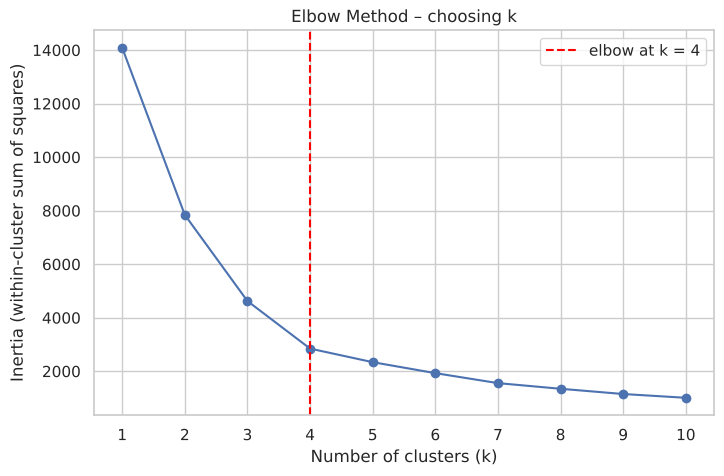
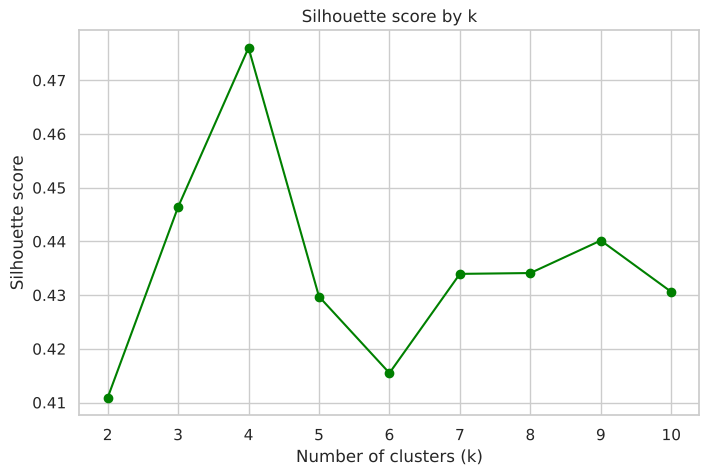

# Optimal Number of Clusters

**Result: the optimal number of clusters is k = 4.** The elbow method shows the bend at k = 4, and the
silhouette score is highest at k = 4 (0.476).

## Files in this folder

| File | Contents |
|---|---|
| `README.md` | This documentation |
| `01_elbow_method.png` | Elbow plot: inertia for k = 1 to 10 |
| `02_silhouette_scores.png` | Silhouette score for k = 2 to 10 |
| `k_selection_scores.csv` | Inertia, the drop between each k, and the silhouette score for k = 1 to 10 |

## 1. Data used for clustering

- **Dataset:** 7,043 telecom customers
- **Features:** `tenure` (months as a customer) and `MonthlyCharges` (dollars per month)
- **Why these two:** together they describe customer lifetime and spend, which gives segments a business
  can name and act on. Using all nine encoded columns gave silhouette scores below 0.19, against 0.48 for
  these two, because the 0/1 columns create artificial splits.
- **Churn left out:** clustering is unsupervised, so churn is not an input. It is used afterwards to test
  whether the segments are meaningful.

## 2. Scaling

K-Means groups points by Euclidean distance. Tenure runs from 0 to 72 and MonthlyCharges from 18 to 119,
so without scaling, charges would dominate. Both features are standardised to z-scores (mean 0,
standard deviation 1):

```
z = (x − mean) / standard deviation
```

```python
from sklearn.preprocessing import StandardScaler

features = ['tenure', 'MonthlyCharges']
scaler_clust = StandardScaler()
X_clust = scaler_clust.fit_transform(df_enc[features])
```

## 3. Elbow method

K-Means was trained for every k from 1 to 10, and its **inertia** was recorded. Inertia is the
within-cluster sum of squares (WCSS): the total squared distance from each customer to their cluster
centre. Lower inertia means tighter clusters.

Inertia always falls as k rises, so the aim is the **elbow**: the point where one more cluster stops
giving a large improvement.

```python
from sklearn.cluster import KMeans

k_range = range(1, 11)
inertia = []
for k in k_range:
    km = KMeans(n_clusters=k, n_init=10, random_state=42)
    km.fit(X_clust)
    inertia.append(km.inertia_)

plt.plot(list(k_range), inertia, marker='o')
plt.axvline(4, color='red', linestyle='--', label='elbow at k = 4')
plt.xlabel('Number of clusters (k)')
plt.ylabel('Inertia (within-cluster sum of squares)')
plt.title('Elbow Method – choosing k')
plt.legend()
plt.show()
```

- `n_init=10`: each k is run 10 times from different random starting centres, and the best run is kept
- `random_state=42`: fixes the random start so the results can be reproduced



| k | Inertia | Drop from previous k | Drop % |
|---|---|---|---|
| 1 | 14,086 | — | — |
| 2 | 7,841 | 6,245 | 44.3% |
| 3 | 4,622 | 3,219 | 41.1% |
| **4** | **2,846** | **1,776** | **38.4%** |
| 5 | 2,339 | 507 | 17.8% |
| 6 | 1,929 | 410 | 17.5% |
| 7 | 1,556 | 373 | 19.3% |
| 8 | 1,345 | 211 | 13.6% |
| 9 | 1,149 | 196 | 14.6% |
| 10 | 1,008 | 141 | 12.3% |

**Reading the elbow:** up to k = 4, each extra cluster cuts inertia by about 40%. From k = 4 to 5 the
cut falls to 17.8%, and it stays below 20% after that. Going from 4 to 5 clusters saves only 507, less
than a third of the 1,776 saved going from 3 to 4. So the curve bends at **k = 4**.

## 4. Silhouette score check

An elbow can be read differently by different people, so it was checked with the **silhouette score**.
For each customer it compares:

- **a** = average distance to the other customers in its own cluster
- **b** = average distance to the customers in the nearest other cluster

```
silhouette = (b − a) / max(a, b)
```

The score runs from −1 to 1. Near 1 means well clustered, near 0 means on a border, and negative means
probably in the wrong cluster. It needs at least two clusters, so it starts at k = 2.

```python
from sklearn.metrics import silhouette_score

sil = {}
for k in range(2, 11):
    labels = KMeans(n_clusters=k, n_init=10, random_state=42).fit_predict(X_clust)
    sil[k] = silhouette_score(X_clust, labels)

best_k = max(sil, key=sil.get)
print('Highest silhouette at k =', best_k, f'({sil[best_k]:.3f})')
# Highest silhouette at k = 4 (0.476)
```



| k | 2 | 3 | **4** | 5 | 6 | 7 | 8 | 9 | 10 |
|---|---|---|---|---|---|---|---|---|---|
| Silhouette | 0.411 | 0.446 | **0.476** | 0.430 | 0.415 | 0.434 | 0.434 | 0.440 | 0.431 |

The silhouette score peaks clearly at **k = 4 (0.476)**. Every other k scores between 0.411 and 0.446.

## 5. Conclusion

| Method | What it measures | Best k |
|---|---|---|
| Elbow method | Where extra clusters stop reducing inertia much | **4** |
| Silhouette score | How tight and well separated the clusters are | **4** (0.476) |

Both methods agree, so the K-Means model is trained with **4 clusters**. A silhouette score of 0.476
means the clusters are reasonably well separated.
