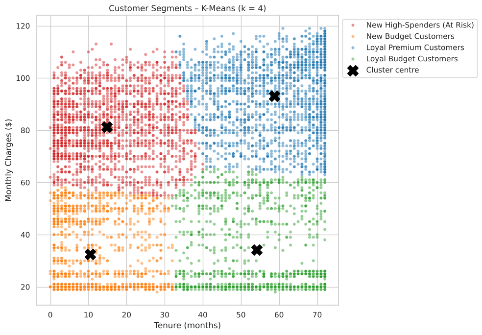
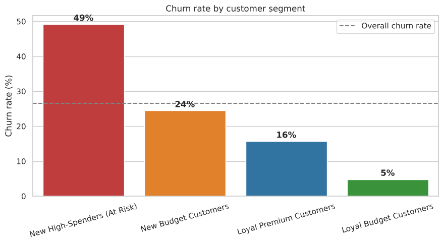
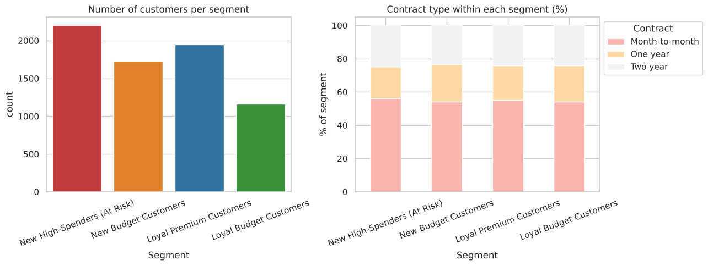

# Visualisation and Labelling of Clusters

**The 4 clusters were labelled New High-Spenders (At Risk), New Budget Customers, Loyal Premium Customers
and Loyal Budget Customers. Churn ranges from 49% to 5% between them, even though churn was not used to
build the clusters.**

## Files in this folder

| File | Contents |
|---|---|
| `README.md` | This documentation |
| `03_cluster_scatter_labelled.png` | Customers coloured by segment, with cluster centres |
| `04_churn_by_segment.png` | Churn rate of each segment against the overall rate |
| `05_segment_size_and_contract_mix.png` | Customers per segment and contract mix within each |
| `cluster_centres.csv` | Each cluster's centre, label and size |
| `segment_profile.csv` | Profile and churn rate of each segment |
| `customer_segments.csv` | All 7,043 customers with their cluster number and segment label |

## 1. Labelling the clusters

K-Means numbers its clusters 0–3 arbitrarily, and the numbers can change between runs. So each label
comes from where the cluster centre sits rather than from its number:

- **Tenure** above the average → *Loyal*; below → *New*
- **Monthly charges** above the average → *High-spend / Premium*; below → *Budget*

```python
tenure_cut = df_enc['tenure'].mean()
charge_cut = df_enc['MonthlyCharges'].mean()

def name_cluster(row):
    long_stay = row['tenure'] >= tenure_cut
    high_spend = row['MonthlyCharges'] >= charge_cut
    if not long_stay and high_spend:
        return 'New High-Spenders (At Risk)'
    if not long_stay and not high_spend:
        return 'New Budget Customers'
    if long_stay and high_spend:
        return 'Loyal Premium Customers'
    return 'Loyal Budget Customers'

cluster_names = centres.apply(name_cluster, axis=1).to_dict()
df_enc['Segment'] = df_enc['Cluster'].map(cluster_names)
```

| Cluster | Segment label | Centre tenure | Centre charges | Customers |
|---|---|---|---|---|
| 0 | **New High-Spenders (At Risk)** | 14.8 months | $81.2 | 2,202 |
| 1 | **New Budget Customers** | 10.5 months | $32.5 | 1,733 |
| 2 | **Loyal Premium Customers** | 58.8 months | $93.1 | 1,948 |
| 3 | **Loyal Budget Customers** | 54.1 months | $34.2 | 1,160 |

## 2. Cluster scatter plot



```python
sns.scatterplot(data=df_enc, x='tenure', y='MonthlyCharges', hue='Segment',
                hue_order=seg_order, palette=palette, alpha=0.5, s=20)
plt.scatter(centres['tenure'], centres['MonthlyCharges'], c='black', marker='X',
            s=250, label='Cluster centre')
```

Each dot is a customer, placed by tenure and monthly charges and coloured by segment. The black X marks
are the cluster centres. The four groups separate clearly:

- **Left (new customers):** New High-Spenders at the top (red), New Budget at the bottom (orange)
- **Right (loyal customers):** Loyal Premium at the top (blue), Loyal Budget at the bottom (green)
- The split between new and loyal falls at about 33 months, and between budget and premium at about $60.

## 3. Segment profiles

```python
profile = df_enc.groupby('Cluster').agg(
    customers=('Churn', 'size'),
    avg_tenure=('tenure', 'mean'),
    avg_monthly_charges=('MonthlyCharges', 'mean'),
    churn_rate=('Churn', 'mean'),
    pct_fiber=('InternetService', 'mean'),
    pct_month_to_month=('Contract', lambda s: (s == 0).mean()),
    pct_senior=('SeniorCitizen', 'mean'),
    pct_dependents=('Dependents', 'mean'),
).round(2)
```

Churn is coded 1/0, so its mean is the churn rate. The same applies to the other percentages.

| Segment | Customers | Avg tenure | Avg monthly | **Churn** | % senior | % dependents | % fiber | % month-to-month |
|---|---|---|---|---|---|---|---|---|
| New High-Spenders (At Risk) | 2,202 | 14.8 mo | $81.23 | **49%** | 23% | 20% | 43% | 56% |
| New Budget Customers | 1,733 | 10.5 mo | $32.49 | 24% | 7% | 30% | 44% | 54% |
| Loyal Premium Customers | 1,948 | 58.8 mo | $93.08 | 16% | 22% | 33% | 45% | 55% |
| Loyal Budget Customers | 1,160 | 54.1 mo | $34.15 | **5%** | 8% | 44% | 44% | 54% |

## 4. Churn rate by segment



The dashed line is the overall churn rate (26.5%). New High-Spenders churn at 49%, almost double the
average. Loyal Budget customers churn at only 5%.

## 5. Segment size and contract mix



- **Left:** the at-risk segment is the largest, with 2,202 customers, so the churn problem is large.
- **Right:** about 55% of every segment is on month-to-month contracts. Contract type does not separate
  the segments; tenure and charges do.

## 6. Insights

1. **The segments are meaningful.** Churn was not an input to the clustering, yet it ranges from 49% to 5%
   across segments.
2. **Churn is concentrated in new customers who pay a lot.** New High-Spenders are the largest segment and
   nearly half of them leave.
3. **Tenure protects against churn.** Both loyal segments churn far less than both new segments.
4. **Price matters most early on.** Among new customers, high spenders churn twice as often as budget
   customers (49% vs 24%).
5. **Demographics differ by segment.** Seniors are more common in the high-spend segments (22–23%), and
   dependents are most common among Loyal Budget customers (44%).
6. **Contract and internet type do not separate the segments.** Their shares are almost equal in all four.

## 7. Recommended actions

| Segment | Churn | Priority | Action |
|---|---|---|---|
| New High-Spenders (At Risk) | 49% | **1 (highest)** | Onboarding check-ins, discounts to move to 1- or 2-year contracts, service-quality follow-up |
| New Budget Customers | 24% | 2 | Nurture: bundle offers and early loyalty perks |
| Loyal Premium Customers | 16% | 3 | Protect the most valuable customers: VIP treatment, priority support, upgrade offers |
| Loyal Budget Customers | 5% | 4 | Stable: low-cost upsell opportunities |

## 8. Limitations

- Only two features were used. This gives clear, actionable segments but ignores services and demographics.
- A silhouette score of 0.476 means reasonable separation; customers near borders could fit a neighbouring segment.
- K-Means assumes roughly round clusters. GMM or DBSCAN could be compared in future work.
